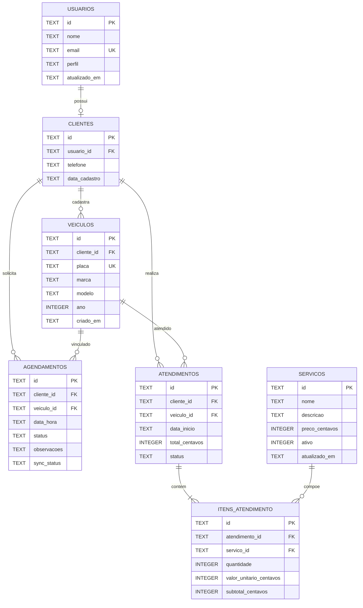

# 5. Modelo entidade-relacionamento do banco local

O banco local será utilizado para armazenar os dados necessários às funcionalidades do aplicativo, manter informações disponíveis offline e registrar alterações aguardando sincronização.

## 5.1 Entidades e atributos

Os tipos abaixo correspondem aos tipos SQLite. Identificadores serão armazenados como `TEXT` no formato UUID.

### USUARIOS
| Coluna | Tipo | Restrição | Descrição |
|---|---|---|---|
| id | TEXT | PK | Identificador do usuário |
| nome | TEXT | NOT NULL | Nome completo |
| email | TEXT | NOT NULL, UNIQUE | E-mail de acesso |
| perfil | TEXT | NOT NULL, CHECK | `cliente` ou `admin` |
| atualizado_em | TEXT | NOT NULL | Data/hora ISO-8601 |

### CLIENTES
| Coluna | Tipo | Restrição | Descrição |
|---|---|---|---|
| id | TEXT | PK | Identificador do cliente |
| usuario_id | TEXT | FK, UNIQUE, NOT NULL | Referência a USUARIOS |
| telefone | TEXT | NOT NULL | Telefone de contato |
| data_cadastro | TEXT | NOT NULL | Data de cadastro |

### VEICULOS
| Coluna | Tipo | Restrição | Descrição |
|---|---|---|---|
| id | TEXT | PK | Identificador do veículo |
| cliente_id | TEXT | FK, NOT NULL | Proprietário/responsável |
| placa | TEXT | UNIQUE, NOT NULL | Placa normalizada |
| marca | TEXT | NOT NULL | Marca |
| modelo | TEXT | NOT NULL | Modelo |
| ano | INTEGER | CHECK | Ano, quando informado |
| criado_em | TEXT | NOT NULL | Data de cadastro |

### SERVICOS
| Coluna | Tipo | Restrição | Descrição |
|---|---|---|---|
| id | TEXT | PK | Identificador do serviço |
| nome | TEXT | NOT NULL | Nome do serviço |
| descricao | TEXT | NOT NULL | Descrição |
| preco_centavos | INTEGER | NOT NULL, CHECK | Preço em centavos |
| ativo | INTEGER | NOT NULL, CHECK | 0 ou 1 |
| atualizado_em | TEXT | NOT NULL | Data de atualização |

### AGENDAMENTOS
| Coluna | Tipo | Restrição | Descrição |
|---|---|---|---|
| id | TEXT | PK | Identificador do agendamento |
| cliente_id | TEXT | FK, NOT NULL | Cliente solicitante |
| veiculo_id | TEXT | FK, NOT NULL | Veículo relacionado |
| data_hora | TEXT | NOT NULL | Data/hora solicitada |
| status | TEXT | NOT NULL, CHECK | Situação do agendamento |
| observacoes | TEXT | NOT NULL | Observações |
| sync_status | TEXT | NOT NULL, CHECK | Estado de sincronização |

### ATENDIMENTOS
| Coluna | Tipo | Restrição | Descrição |
|---|---|---|---|
| id | TEXT | PK | Identificador do atendimento |
| cliente_id | TEXT | FK, NOT NULL | Cliente atendido |
| veiculo_id | TEXT | FK, NOT NULL | Veículo atendido |
| data_inicio | TEXT | NOT NULL | Início do atendimento |
| total_centavos | INTEGER | NOT NULL, CHECK | Total em centavos |
| status | TEXT | NOT NULL, CHECK | Situação do atendimento |

### ITENS_ATENDIMENTO
| Coluna | Tipo | Restrição | Descrição |
|---|---|---|---|
| id | TEXT | PK | Identificador do item |
| atendimento_id | TEXT | FK, NOT NULL | Atendimento relacionado |
| servico_id | TEXT | FK, NOT NULL | Serviço executado |
| quantidade | INTEGER | NOT NULL, CHECK | Quantidade |
| valor_unitario_centavos | INTEGER | NOT NULL, CHECK | Preço histórico unitário |
| subtotal_centavos | INTEGER | NOT NULL, CHECK | Subtotal do item |

### FILA_SINCRONIZACAO
| Coluna | Tipo | Restrição | Descrição |
|---|---|---|---|
| id | TEXT | PK | Identificador da operação |
| entidade | TEXT | NOT NULL | Nome da entidade alterada |
| entidade_id | TEXT | NOT NULL | UUID do registro |
| operacao | TEXT | NOT NULL, CHECK | criar, atualizar ou excluir |
| payload_json | TEXT | NOT NULL | Dados da operação |
| criado_em | TEXT | NOT NULL | Data/hora da inclusão |
| tentativas | INTEGER | NOT NULL, CHECK | Quantidade de tentativas |

## 5.2 Relacionamentos

- USUARIOS 1 : 0..1 CLIENTES — um usuário com perfil cliente pode possuir um cadastro de cliente.
- CLIENTES 1 : N VEICULOS — um cliente pode cadastrar vários veículos.
- CLIENTES 1 : N AGENDAMENTOS — um cliente pode solicitar vários agendamentos.
- VEICULOS 1 : N AGENDAMENTOS — um veículo pode estar associado a vários agendamentos.
- CLIENTES 1 : N ATENDIMENTOS — um cliente pode possuir vários atendimentos.
- VEICULOS 1 : N ATENDIMENTOS — um veículo pode possuir vários atendimentos.
- ATENDIMENTOS 1 : N ITENS_ATENDIMENTO — um atendimento contém um ou mais itens.
- SERVICOS 1 : N ITENS_ATENDIMENTO — um serviço pode aparecer em vários itens de atendimento.

## 5.3 Diagrama ER

## 5.4 Restrições e integridade

- Todas as tabelas possuem chave primária.
- Chaves estrangeiras garantem os relacionamentos.
- Campos essenciais utilizam `NOT NULL`.
- E-mail e placa possuem restrição `UNIQUE`.
- Valores monetários são armazenados como números inteiros em centavos.
- Preços, subtotais e totais não podem ser negativos.
- Quantidades devem ser maiores que zero.
- Campos de situação utilizam valores permitidos definidos por `CHECK`.
- A aplicação deverá habilitar `PRAGMA foreign_keys = ON`.
- A validação de que o veículo pertence ao cliente deverá ocorrer na aplicação e também na API.
